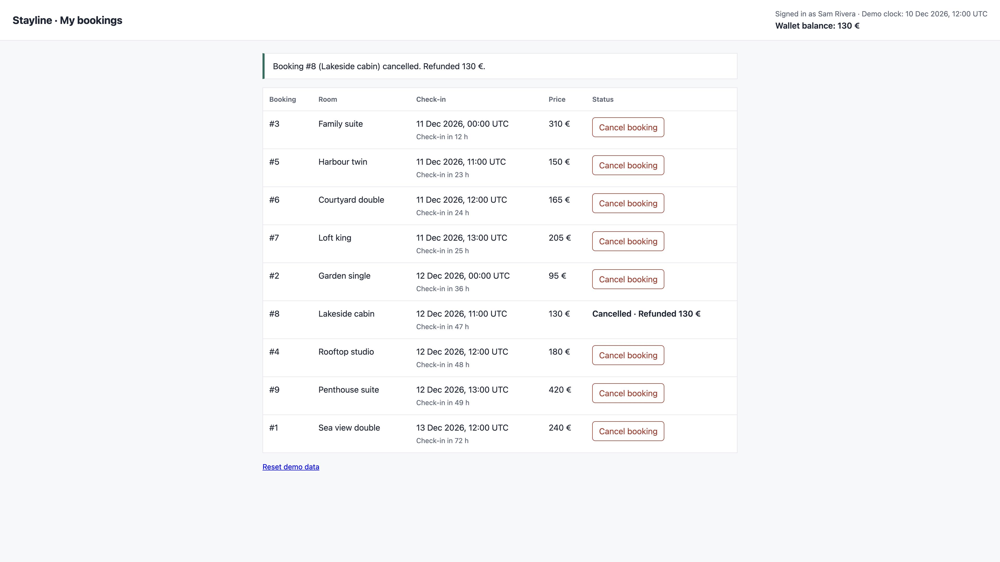

# Spec Delta

**When the spec changes, your green suite lies.** Spec Delta uses Kane CLI to prove the lie in a real browser. It then hands the failure to your coding agent and keeps going until the same test proves the new rule.

```bash
node bin/spec-delta.mjs --agent codex
```

The command runs five steps:

1. **reconcile**: `kane-cli maintain reconcile` reads the changed spec, designs the tests the change calls for.
2. **verify**: `kane-cli testrun run` runs every designed test in Chrome against the running app.
3. **fix**: each failing test goes to the agent with the step that failed, Kane's verdict, the screenshot from the evidence pack, the spec diff and the full spec.
4. **re-verify**: Spec Delta restarts the app and the **same** test files run again. Their sha256 is locked before the agent starts, for up to `--max-rounds` rounds.
5. **prove**: `kane-cli cover` reports how many of the spec's acceptance criteria are proven by passing runs.

> Built for the KaneCLI Online Hackathon (12–26 Nov 2026).

## The story in three tags

| Tag | Spec | App | Kane suite |
|---|---|---|---|
| `spec-v1-green` | refunds need **24 h** notice | refunds at 24 h | designed by Kane at 23, 24 and 25 h: all green, 7/7 criteria proven |
| `spec-v2-red` | refunds need **48 h** notice | still refunds at 24 h | the old suite would still pass. Reconcile designs 47, 48 and 49 h tests, and **47 h fails in Chrome** |
| `spec-v2-green` | 48 h | fixed by Codex | the same three files pass, **10/10 criteria proven** |

The failure Kane caught at 47 h was booking #8, refunded 130 € when the spec says it should get nothing:



The final report from that run is [evidence/03-report.md](evidence/03-report.md):

| Test | sha256 (locked) | First run | Final |
|---|---|---|---|
| late cancellation leaves wallet unchanged at 47 hours | 2af819b3f98e | failed | passed |
| exact 48 hour cancellation credits the full amount | 99cf02cc3cf9 | passed | passed |
| early cancellation credits the full amount after 48 hours | 50a35c279576 | passed | passed |

The prompt the agent received is in [evidence/03-agent-prompt.md](evidence/03-agent-prompt.md). The fix itself is one line in `src/policy.js`, plus the unit tests the agent added.

## The referee does not move

An agent told "make the test pass" can also make it pass by editing the test. Spec Delta rules that out:

- **Hash lock.** The designed tests are hashed before the first fix round, and the report shows the same hash going from red to green.
- **Guard.** Before the agent runs, Spec Delta snapshots the spec, every `*_test.md`, `.testmuai/`, `tests/kane/`, `evidence/` and `.context/` byte for byte. Any change the agent makes there is reverted and reported. A clean round prints `referee intact`.
- **The spec decides.** The prompt names the spec as the source of truth and tells the agent to fix the application only. This mattered in practice. Kane's own run summary suggested "updating the late-booking fixture", which would have hidden the bug. Codex fixed the refund rule instead.

## Replay the loop

You need Node 20+, Google Chrome and Kane CLI (`npm install -g @testmuai/kane-cli`, then `kane-cli login`). You also need either Codex CLI or Claude Code as the agent.

```bash
npm run demo     # put the 24 h refund rule back, then run red → agent fix → green
```

`npm run demo` checks out the buggy `src/policy.js` and its unit tests from `spec-v2-red`. It then runs `spec-delta` with `--skip-reconcile`, because the v2 suite is already committed. Afterwards, `git diff` shows the agent's fix, and `git checkout -- src test` restores the committed one.

Other commands:

```bash
npm start            # Stayline on http://localhost:3000 (/reset restores the demo data)
npm test             # unit and HTTP tests (Node's built-in runner)
npm run kane:suite   # the hand-written spec v1 suite in tests/kane
node bin/spec-delta.mjs --agent claude   # or --agent none to only write the prompt
```

Every run writes its prompt, its screenshots, `locks.json` and `report.md` to `.spec-delta/<timestamp>/`.

### Options

| Option | Default | |
|---|---|---|
| `--spec` | `SPEC.md` | the requirement document Kane reconciles against |
| `--source-id` | `spec` | the source id the spec was ingested under |
| `--tests` | `.testmuai/tests` | the folder of Kane-designed tests |
| `--agent` | `codex` | `codex`, `claude` or `none` |
| `--max-rounds` | `2` | fix rounds before giving up |
| `--app-cmd` | `node server.js` | how to start the app (restarted after every fix) |
| `--app-url` | `http://localhost:3000/` | polled until the app answers |
| `--start-url` | `http://localhost:3000/reset` | where every Kane test starts |
| `--skip-reconcile` | off | run the committed suite as it is |

## The demo app: Stayline

Stayline is a hotel booking app with no dependencies. Its clock is frozen at 10 Dec 2026 12:00 UTC, so every run sees the same nine bookings. Their check-in times bracket both refund cutoffs:

| Booking | Check-in in | Price | Refunded under spec v1 (24 h) | Refunded under spec v2 (48 h) |
|---|---|---|---|---|
| #3 | 12 h | 310 € | no | no |
| #5 | 23 h | 150 € | no | no |
| #6 | 24 h | 165 € | yes (boundary) | **no** |
| #7 | 25 h | 205 € | yes | **no** |
| #2 | 36 h | 95 € | yes | **no** |
| #8 | 47 h | 130 € | yes | **no** |
| #4 | 48 h | 180 € | yes | yes (boundary) |
| #9 | 49 h | 420 € | yes | yes |
| #1 | 72 h | 240 € | yes | yes |

The hand-written suite in `tests/kane` only covers 72 h and 12 h. Those two cases have the same outcome under either spec, so that suite stays green after the rule changes while bookings between 24 h and 48 h are still refunded. That is the lie.

## Layout

| Path | What it is |
|---|---|
| `bin/spec-delta.mjs` | the loop: reconcile, verify, fix, re-verify, prove |
| `SPEC.md` | the requirement: now spec v2, with a 48 h cutoff |
| `demo/SPEC.v2.md` | the v2 spec, kept for replays |
| `src/policy.js` | the refund rule (`REFUND_CUTOFF_HOURS`) |
| `.testmuai/tests/*_test.md` | the suite Kane designed from the spec |
| `.testmuai/variables/assurance.json` | the bookings each designed test uses |
| `tests/kane/*_test.md` | the hand-written spec v1 suite |
| `evidence/` | the run logs, the red screenshot, the agent prompt and the final report |

Kane's sealed evidence packs (`.evidence`) are not committed, because they embed paths from the machine that recorded them. Run the loop to produce your own in `.testmuai/evidence/`.

## Known Kane CLI quirks we worked around

- The first test of a `testrun` batch sometimes fails to attach to Chrome. Spec Delta retries `broken` members once.
- Replayed tests need `--override-start-url`, which Spec Delta always passes.
- After a spec change, `reconcile` reuses variable names from the old suite, so `assurance.json` must point them at the new boundary bookings.
- Archiving trusted nodes needs an interactive `kane-cli context review`.

## License

MIT
